# ShopApp user manual

ShopApp runs your shop: selling at the till, products and stock, customers who buy on credit, expenses and reports. Every screen is available in **English** and **Kiswahili**.

> This manual is also inside the app: open **Help** in the menu (owners) or under your name at the top right (sellers). In the Windows app, press <kbd>F1</kbd>.

## Getting started

### Owner and seller

ShopApp has two kinds of user:

| What you can do | Owner | Seller |
|---|:---:|:---:|
| Sell at the till, see your own sales, print receipts | ✅ | ✅ |
| Add stock received | ✅ (can also change prices) | ✅ (quantity and expiry only) |
| Customers, credit buyers, record repayments | ✅ | ✅ |
| See alerts (expiry, low stock, overdue credit) | ✅ | ✅ |
| Create, edit and delete products and tags | ✅ | ❌ |
| See buying prices and profit | ✅ | ❌ |
| Expenses, reports, users, settings | ✅ | ❌ |
| Delete a sale (its items go back into stock) | ✅ | ❌ |

### First-time setup

The very first time ShopApp opens, it asks you to **set up your shop**:

1. Type the **shop name** (you can leave it empty and change it later in *Settings*).
2. Create the **owner account**: name, email, password and language.
3. Tick **Add a seller account** if someone else will sell, and fill in their details. You can add more users later under *Users*.
4. Press **Finish setup**.

You only do this once. Afterwards the setup page closes for good.

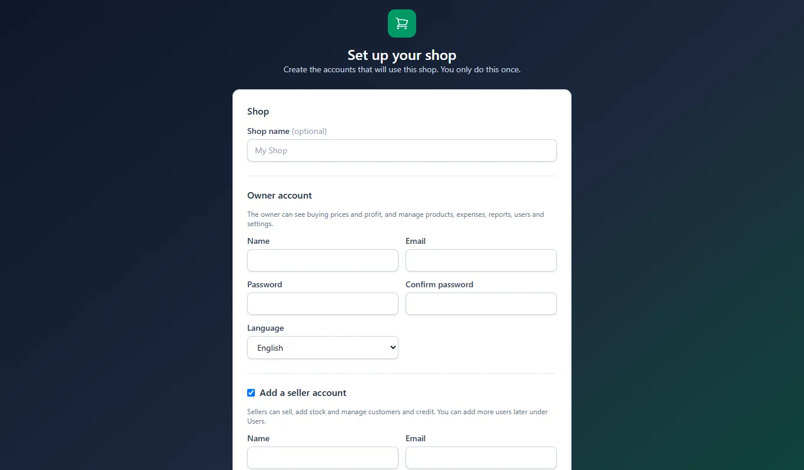

### Logging in and choosing a language

Type your **email** and **password** and press **Log in**. Tick **Remember me** on your own computer so you stay logged in.

Switch the language at any time with the **EN / SW** buttons (on the login page, at the top of every screen, or in *My profile*). ShopApp remembers each user's choice.

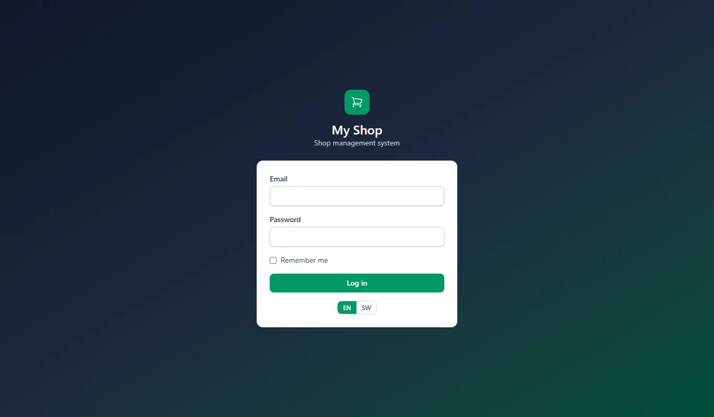

To log out, click your name at the top right and choose **Log out**. To change your name, language or password, choose **My profile**.

## The owner's dashboard

The dashboard is the first screen the owner sees. It shows how the shop is doing today:

- **Sales today**, **Profit today** (with today's expenses), **This month net profit** and **Credit outstanding** (money customers still owe).
- **Sales chart**: switch between **Daily** (last 30 days), **Monthly** (last 12 months) and **Yearly**. Point at a bar to see that day's, month's or year's total and number of sales.
- **Recent sales**: click a sale to open it.
- **Near expiry**, **Low stock** and **Top credit buyers**: click an item or customer to open it.

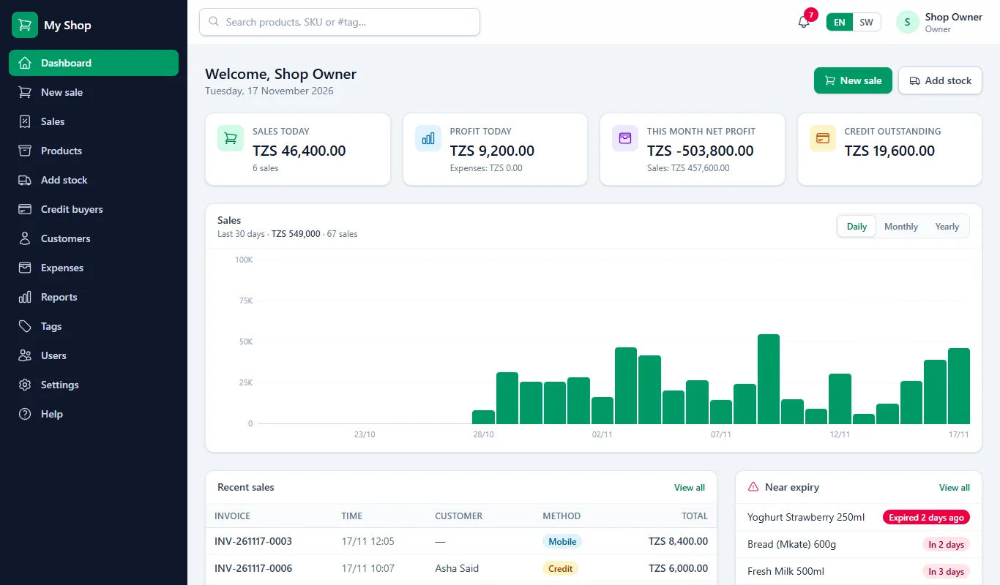

The buttons at the top right, **New sale** and **Add stock**, take you straight to the two jobs you do most.

## The seller's home screen

Sellers get a simple screen of big buttons, made for touch screens:

- **Sell**: open the till.
- **Restock**: record goods received.
- **Credit customers**: who owes money, and record repayments.
- **My sales**: your receipts, and reprinting them.
- **Customers**, **Products** (check prices and stock) and **Alerts**.

The red and amber badges count low-stock items, customers who owe money and alerts. *My sales today* shows your total so far. The bar at the top (*Home*, *Sell*, *My sales*, *Credit buyers*, *Add stock*) is always there.

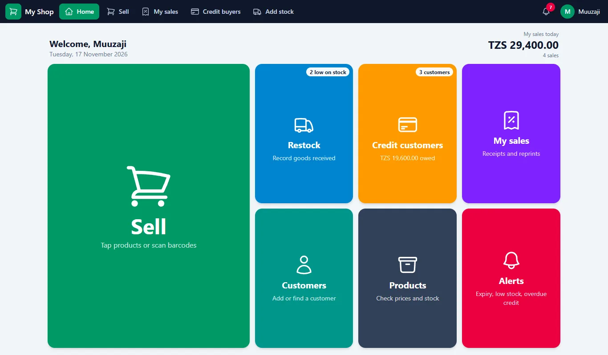

## Selling at the till

Open the till with **New sale** (owner) or **Sell** (seller).

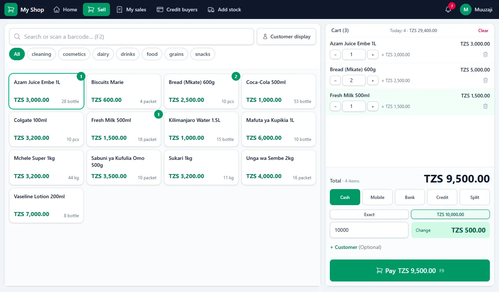

### 1. Add items

- **Tap a product tile**, or **scan its barcode**. Each tap or scan adds one more.
- To find a product, type part of its name, barcode or tag in the search box (press <kbd>F2</kbd> to jump there). Use <kbd>↑</kbd> <kbd>↓</kbd> and <kbd>Enter</kbd> to pick it.
- The category buttons (*All*, *drinks*, *food*, …) show one group of products at a time.
- In the **Cart** on the right, change the quantity with **−** and **+** or type it, and remove a line with the bin icon. **Clear** empties the cart.

ShopApp never lets you sell more than you have, and refuses expired items with a warning beep.

### 2. Take payment

Choose how the customer pays:

| Method | What to do |
|---|---|
| **Cash** | Tap **Exact** or a round amount (or type the cash received). The **Change** is worked out for you. |
| **Mobile** | Mobile money (M-Pesa, Tigo Pesa, Airtel Money…). |
| **Bank** | Card or bank transfer. |
| **Credit** | The customer pays part now, or nothing, and owes the rest (see below). |
| **Split** | Part cash, part mobile, part bank. Type each amount; **Rest** puts whatever is left on that method. Change comes from the cash part. |

### 3. Press Pay

Press **Pay** (or <kbd>F9</kbd>). The sale is saved, stock goes down, and a box shows the change to give back.

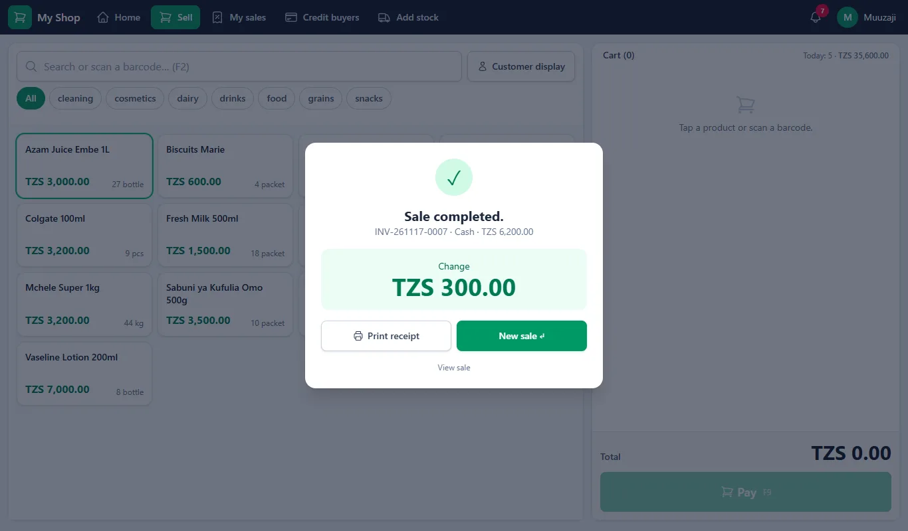

- **Print receipt** prints the receipt. If *auto-print* is on in *Settings*, it prints by itself.
- **New sale** (or <kbd>Enter</kbd>, or just scan the next item) starts the next customer.
- **View sale** opens the full sale.

### Selling on credit

Choose **Credit** and type the **amount paid now** (0 if nothing). A **customer is required** so the balance can be followed up: pick one from the list, or choose *Walk-in / new customer* and type a name and phone number. Set a **due date** for when they should pay.

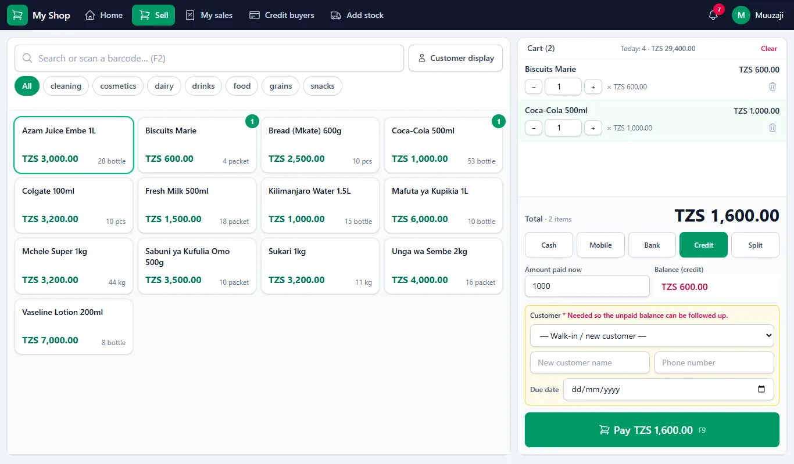

The same applies when a split payment does not cover the whole bill: the rest becomes credit.

For cash, mobile and bank sales the customer is optional. Tap **+ Customer** if you want the sale under their name.

### The receipt

The receipt shows the shop name, invoice number, date, seller, customer, items, total, the amount paid and any balance and due date. For your privacy, it does **not** show how the customer paid. To print it again, open the sale from *Sales* (or *My sales*) and press **Print receipt**.

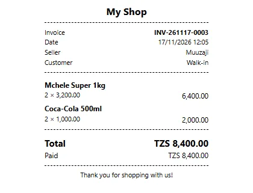

### Customer display (second screen)

If a second screen faces the customer, it shows their items as you scan them, the last item in large type, the total to pay, and the money paid and change. After payment it says *Thank you* for 15 seconds, then shows a welcome screen.

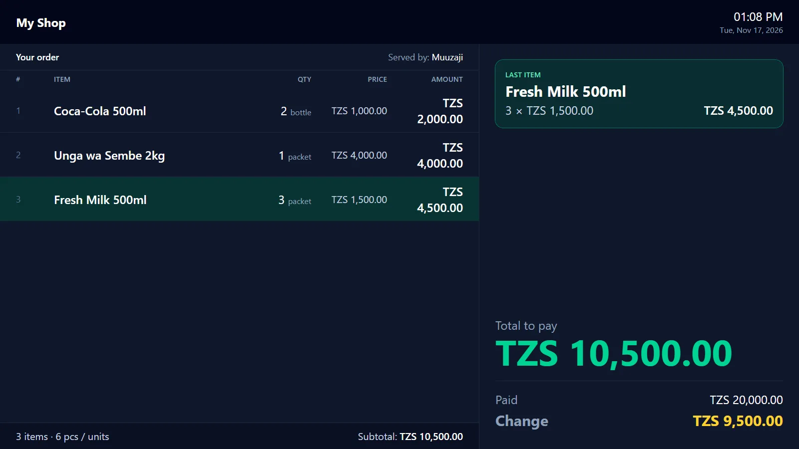

- **Windows app**: it opens on the second screen by itself. Turn it on or off with <kbd>Ctrl</kbd>+<kbd>Shift</kbd>+<kbd>D</kbd> or under *Settings → Devices on this computer*.
- **Web browser**: press **Customer display** on the till, drag the window to the second screen and press <kbd>F11</kbd>.

## Sales and receipts

**Sales** lists every sale (sellers see only their own). Search by invoice, customer or phone, and filter by date, payment method or seller. Click a sale to open it.

On a sale you can:

- **Print receipt** (thermal printer) or **A4** (full page).
- **Record payment** if a balance is still owed (see *Credit buyers*).
- **Delete sale** (owner only). Its items go back into stock. Use this for mistakes only.

## Products

**Products** lists everything you sell, with price, stock and expiry. Search by name, barcode or tag, filter by tag or by *In stock*, *Low stock*, *Out of stock* and *Near expiry*, and sort by name, price, quantity, expiry date or newest.

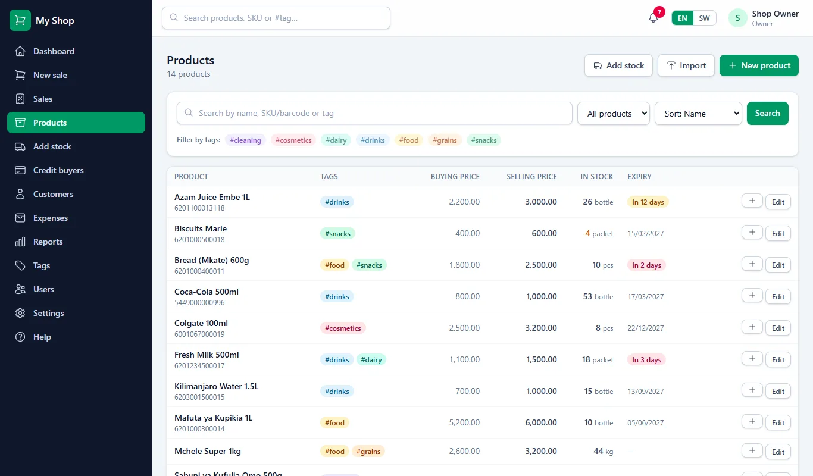

### Adding or editing a product (owner)

Press **New product**, or **Edit** on a product:

- **Product name** (must be unique) and **SKU / Barcode**. Scan the barcode with the cursor in that box.
- **Unit** (pcs, bottle, kg, packet…).
- **Buying price** and **Selling price**. The **profit per unit** is shown as you type.
- **Quantity in stock** and **Reorder level**: when stock falls to the reorder level, the product shows under *Low stock*.
- **Expiry date** (optional) and **Tags**. Type new tags separated by commas.

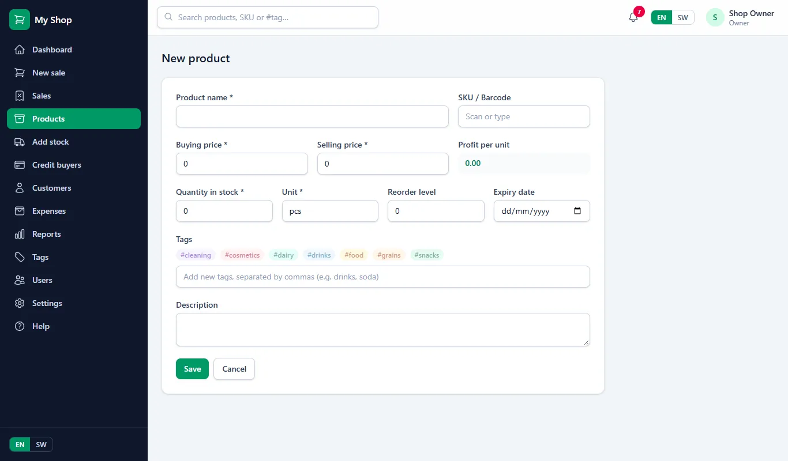

### Importing many products at once (owner)

**Products → Import** adds a whole list from a CSV file:

1. Press **Download template** and open it in Excel.
2. Fill one product per row: `name`, `buying_price` and `selling_price` are required; `sku`, `unit`, `quantity`, `reorder_level`, `expiry_date`, `tags` (separated by `;`) and `description` are optional.
3. Save as **CSV** (*File → Save As → CSV*), choose the file and press **Import**.

Rows whose name already exists are skipped and listed, so you can fix them.

> **Barcodes in Excel:** format the barcode column as **Text** before typing. Otherwise Excel turns long codes into `6.00123E+12` and they are lost.

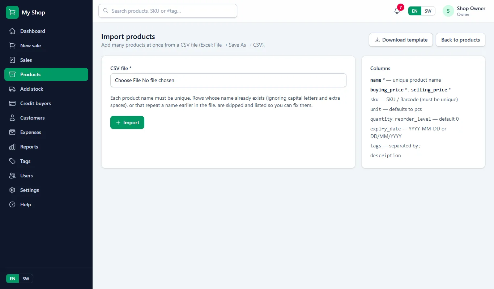

## Adding stock (goods received)

When goods arrive, open **Add stock** (sellers: **Restock**):

1. Tap each product in the list on the left, or scan it. To receive something new, press **New product** first (owner).
2. On the right, type the **Quantity** received and, if the batch has one, the **Expiry date**. The owner can also update the **Buying price** and **Selling price**.
3. Optionally type the **Supplier**. The **Total cost** is shown.
4. Press **Save stock**.

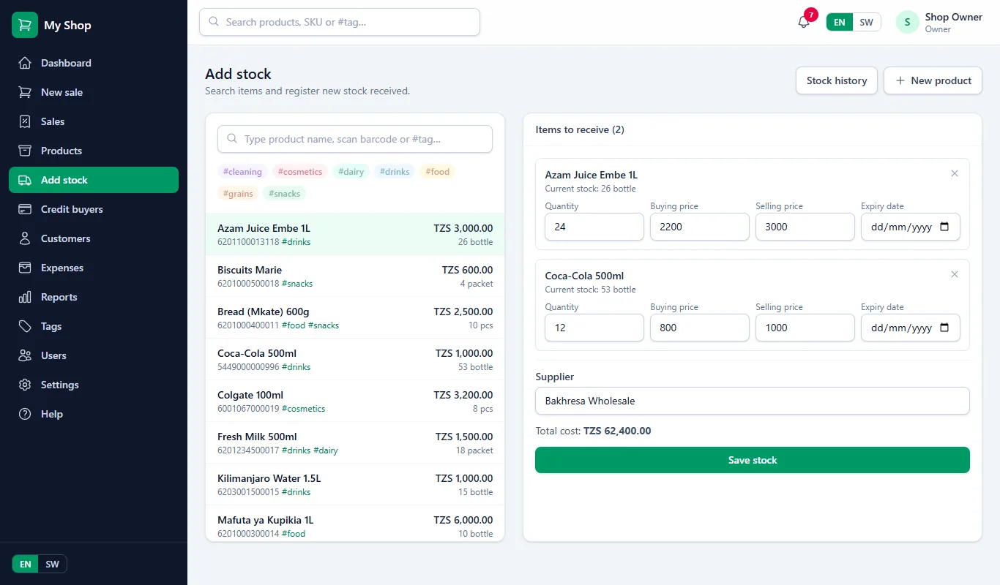

**Stock history** lists everything received, by date and supplier.

## Credit buyers and repayments

**Credit buyers** shows who owes the shop money: the **total outstanding**, each customer's balance (**By customer**) and every **unpaid invoice** with its due date. Overdue invoices are marked in red.

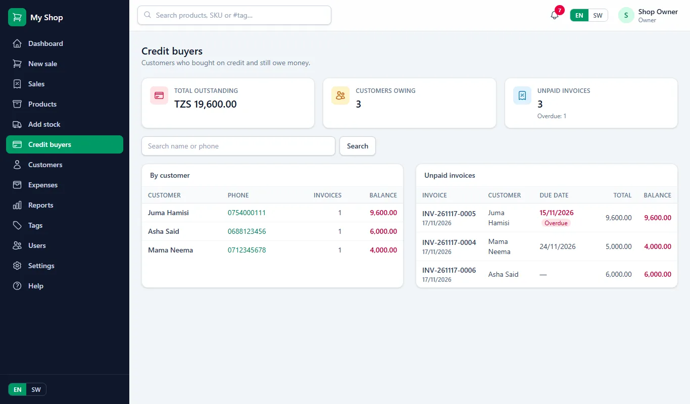

### Recording a repayment

Customers can pay in instalments:

1. Click the invoice (or open the customer, then the invoice).
2. Under **Record payment**, type the amount, choose how they paid, and add a note if you like.
3. Press **Save payment**. The balance goes down. When it reaches zero, the invoice is paid.

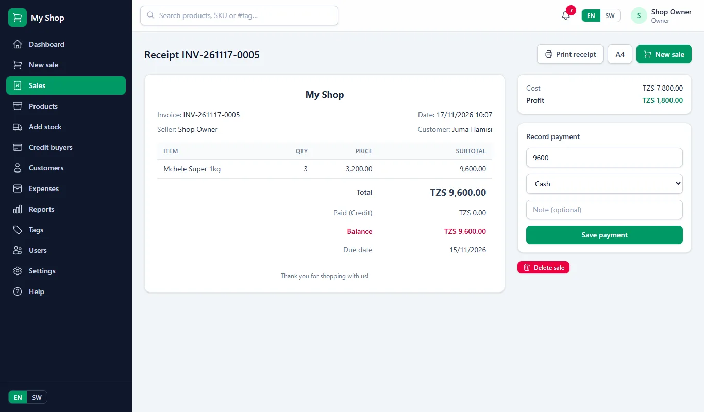

### Customers

**Customers** keeps names, phone numbers and addresses. A customer's page shows everything they bought, what they paid and what they still owe. Only the owner can delete a customer.

## Alerts

The **bell** at the top shows how many things need attention. The **Alerts** page lists:

- **Expired items** still in stock: remove them from the shelf.
- **Near expiry**: items expiring within the number of days set in *Settings* (30 by default).
- **Low stock**: items at or below their reorder level. Press **Restock** to add stock.
- **Overdue credit**: invoices past their due date.

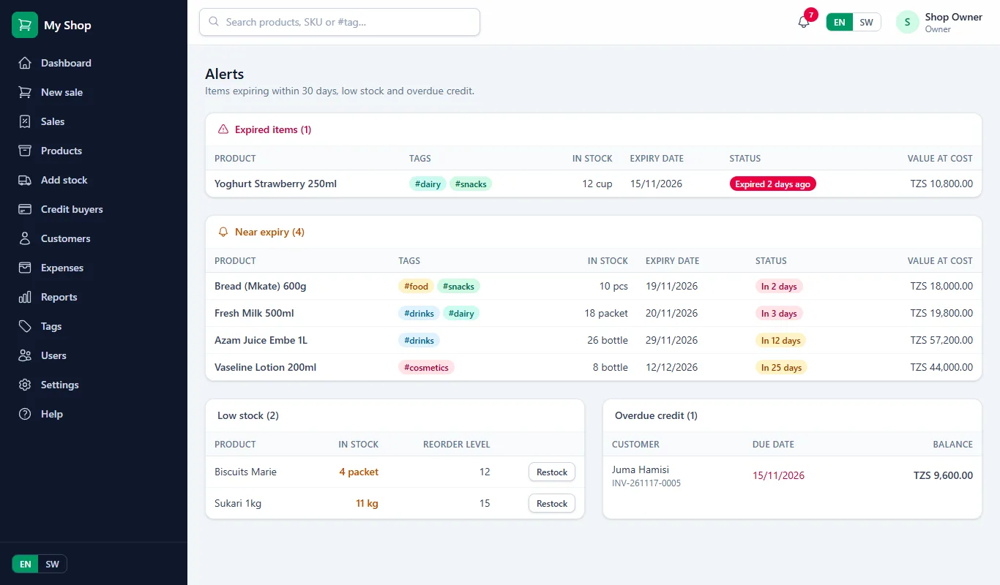

## Expenses (owner)

Record what the shop spends, such as electricity (LUKU), water, food, salaries, rent, transport, taxes and maintenance. Press **Add expense**, then choose the **date**, **category** and **amount**, and add a description. Filter the list by category and dates. Expenses are taken off your profit in *Reports* and on the dashboard.

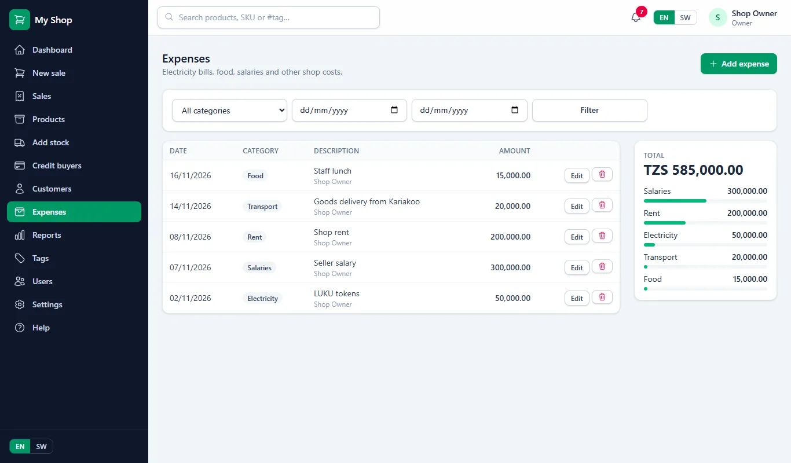

## Reports (owner)

**Reports** shows how the shop did over a **day**, **month** or **year**. Pick the period and date (and a seller if you like) and press **Show report**.

- **Revenue**, **Cost of goods**, **Gross profit**, **Expenses** and **Net profit**.
- **Money received** (including credit repayments) and **Sold on credit (unpaid)**.
- A breakdown by hour, day or month, **Top products**, **Payment methods**, **Sales by seller** and **Expenses by category**.

Press **Print** for a paper copy, or **CSV** to open the figures in Excel.

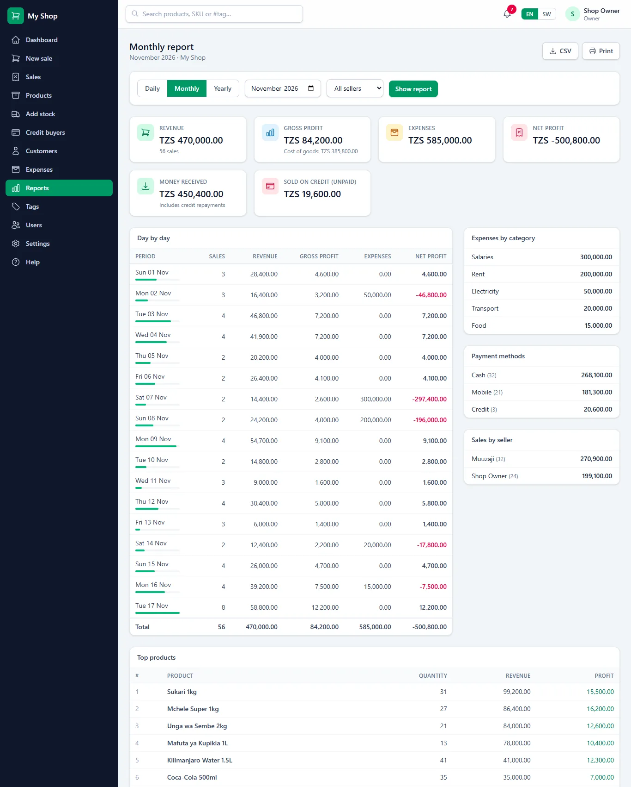

## Tags (owner)

Tags group products, such as *drinks*, *food* or *cosmetics*, so you can find them quickly. They become the category buttons on the till. Create a tag with a name and colour, and give products their tags on the product form.

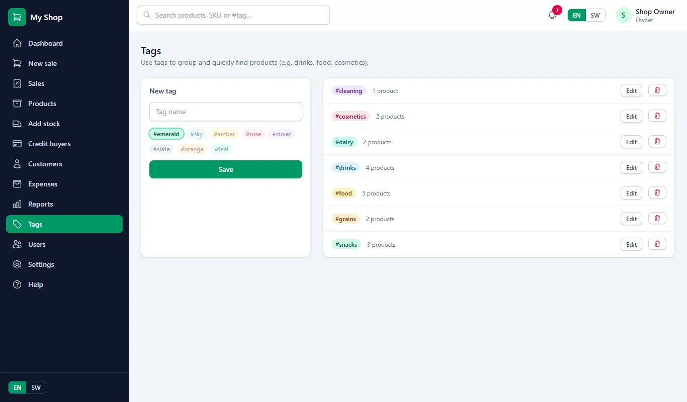

## Users (owner)

**Users** lists everyone who can log in. Press **New user** and set the name, email, password, **role** (owner or seller) and language. To stop someone logging in without deleting their sales history, untick **Active (can log in)**.

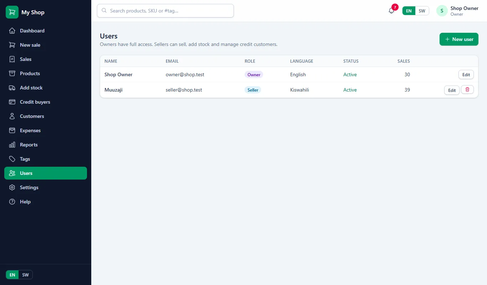

## Settings (owner)

- **Shop**: shop name, phone, address (printed on receipts) and currency.
- **Expiry alert**: how many days before expiry an item shows as *near expiry*.
- **Receipt printer & barcode scanner**: receipt paper width (58 or 80 mm), a footer line (for example *Goods once sold are not returnable*), **print the receipt automatically after every sale**, and the beep when a barcode is scanned. **Print test receipt** checks the printer.
- **Backups**: ShopApp backs up the shop data by itself. Choose **how often** (every hour, day or week) and **at what time**, and **how many automatic backups to keep**. If the computer is off at that time, the backup is made as soon as ShopApp opens again. For extra safety, choose a folder on a **USB drive or OneDrive / Google Drive** to receive a copy of every backup. **Back up now** makes one straight away, and *Recent backups* lets you download them. In the Windows app you can also back up when ShopApp closes, open the backup folder and **restore a backup**.
- **Devices on this computer** (Windows app only): which printer to use, the printing method, opening the cash drawer with every receipt, the customer display screen, the on-screen keyboard, and a box to test the barcode scanner.

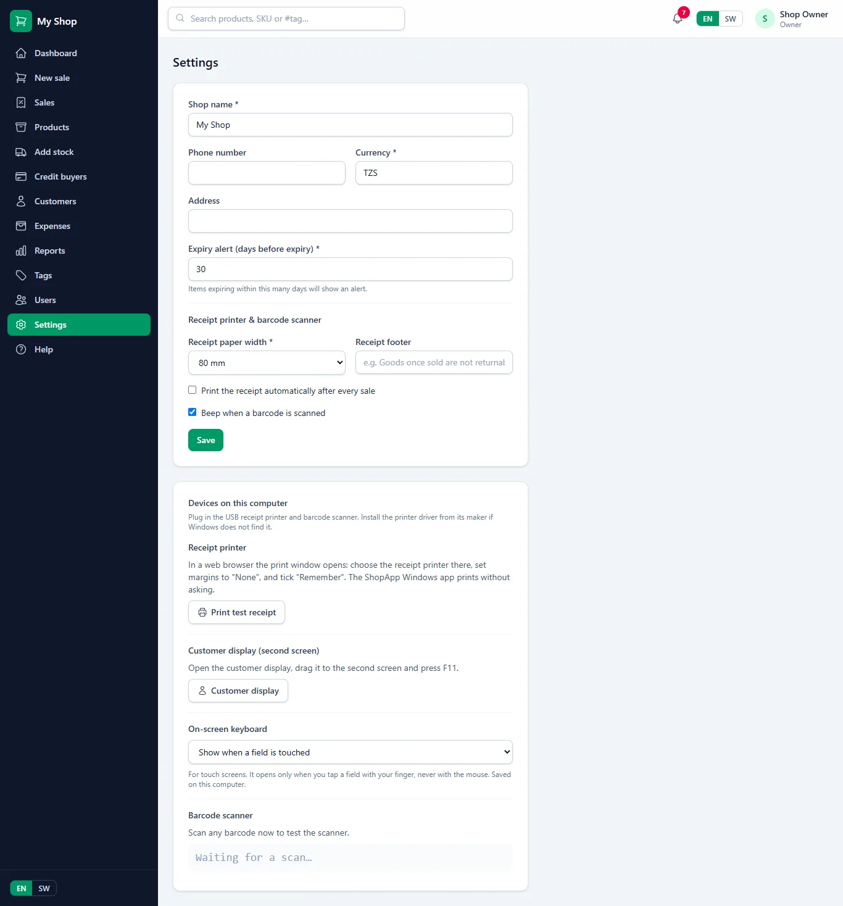

## Barcode scanner and receipt printer

**Barcode scanner** (USB or Bluetooth): plug it in and scan. No setup is needed.

| Where you scan | What happens |
|---|---|
| Till | The item is added to the cart, or its quantity goes up by one. |
| Add stock | The item is added, or its quantity goes up by one. |
| New / edit product | The code goes into *SKU / Barcode*. |
| Anywhere else | The product opens. If the code is unknown, the owner is offered a new product with the code filled in. |

**Receipt printer** (58 or 80 mm thermal): plug it in and install the maker's driver if Windows does not find one. In the Windows app, receipts print straight away with no print window. In a web browser, choose the receipt printer in the print window, set margins to *None*, and the browser will remember it.

**Cash drawer**: plug it into the printer, then tick *Open the cash drawer with every receipt* under *Settings → Devices on this computer*.

## The Windows app

- **Date check**: each time ShopApp starts, confirm that the computer's date and time are right. Sales, expiry alerts and reports depend on them.
- **Backups**: backups run automatically on the schedule in *Settings → Backups*, and one is also taken before every update. Use **File → Back up data now** at any time, and **File → Restore a backup…** (or *Settings → Backups → Restore a backup…*) to go back to one. Restoring first backs up the current data, then restarts ShopApp.
- **Updates**: ShopApp checks for updates when it starts (and under **Help → Check for updates**), downloads them, then asks to restart.
- **Shortcuts**: <kbd>F1</kbd> this manual · <kbd>F11</kbd> full screen · <kbd>Ctrl</kbd>+<kbd>Shift</kbd>+<kbd>D</kbd> customer display on/off · <kbd>Ctrl</kbd>+<kbd>Shift</kbd>+<kbd>M</kbd> show/hide the menu bar.
- **Touch screens**: tapping a field with your finger opens ShopApp's own on-screen keyboard. You can turn it off in *Settings → Devices on this computer*.

## Questions and problems

**A barcode does not find the product.** Scan it in *Settings → Devices on this computer → Barcode scanner* to see exactly what the scanner sends, then correct the product's *SKU / Barcode*.

**The receipt prints blank or too small.** Check the paper width in *Settings*, then use **Print test receipt**. In the Windows app, keep the printing method on *Direct to thermal printer (ESC/POS)*.

**I can't sell an item.** It is either out of stock (add stock first) or expired (it cannot be sold).

**A sale was entered wrongly.** The owner can open it and press **Delete sale**. Its items go back into stock. Then enter it again.

**A seller forgot their password.** The owner opens *Users*, edits the seller and types a new password.

**I don't see Reports, Expenses or Settings.** Those are for the owner only.
