# Mwongozo wa mtumiaji wa ShopApp

ShopApp inaendesha duka lako: kuuza kaunta, bidhaa na mzigo, wateja wanaonunua kwa mkopo, matumizi na ripoti. Kila skrini inapatikana kwa **Kiingereza** na **Kiswahili**.

> Mwongozo huu upo pia ndani ya programu: fungua **Msaada** kwenye menyu (mmiliki) au chini ya jina lako juu kulia (muuzaji). Kwenye programu ya Windows, bonyeza <kbd>F1</kbd>.

## Kuanza

### Mmiliki na muuzaji

ShopApp ina aina mbili za watumiaji:

| Unachoweza kufanya | Mmiliki | Muuzaji |
|---|:---:|:---:|
| Kuuza kaunta, kuona mauzo yako, kuchapisha risiti | ✅ | ✅ |
| Kuongeza mzigo uliopokelewa | ✅ | ❌ |
| Wateja, wanunuzi wa mkopo, kurekodi marejesho | ✅ | ✅ |
| Kuona tahadhari (kuisha muda, mzigo mdogo, madeni yaliyopitiliza) | ✅ | ✅ |
| Kuongeza, kuhariri na kufuta bidhaa na lebo | ✅ | ❌ |
| Kuona bei za kununua na faida | ✅ | ❌ |
| Matumizi, ripoti, watumiaji, mipangilio | ✅ | ❌ |
| Kufuta mauzo (bidhaa zake zinarudi stoo) | ✅ | ❌ |

### Maandalizi ya mara ya kwanza

Mara ya kwanza kabisa ShopApp inapofunguliwa, inakuomba **uandae duka lako**:

1. Andika **jina la duka** (unaweza kuliacha wazi na kulibadilisha baadaye kwenye *Mipangilio*).
2. Fungua **akaunti ya mmiliki**: jina, barua pepe, nenosiri na lugha.
3. Weka alama kwenye **Ongeza akaunti ya muuzaji** kama kuna mtu mwingine atakayeuza, kisha jaza taarifa zake. Unaweza kuongeza watumiaji wengine baadaye kwenye *Watumiaji*.
4. Bonyeza **Maliza maandalizi**.

Unafanya hivi mara moja tu. Baada ya hapo ukurasa wa maandalizi unafungwa kabisa.

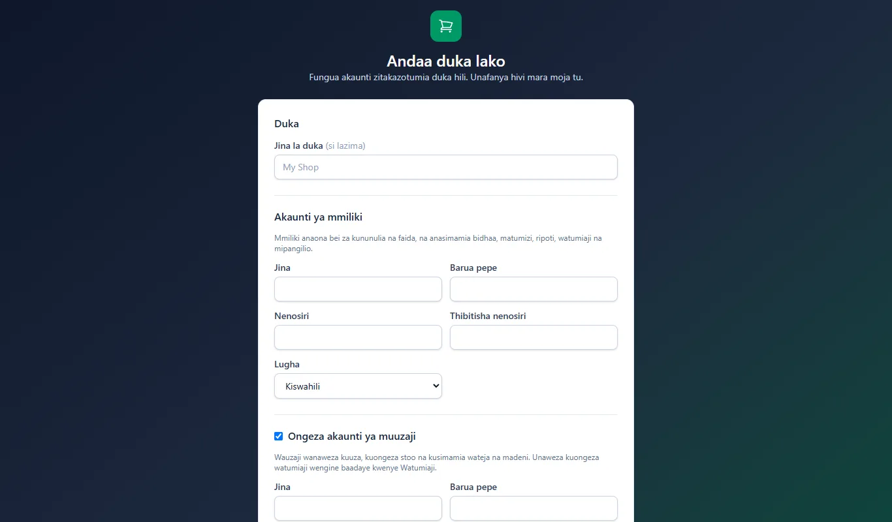

### Kuingia na kuchagua lugha

Andika **barua pepe** na **nenosiri** lako kisha bonyeza **Ingia**. Weka alama kwenye **Nikumbuke** kwenye kompyuta yako mwenyewe ili usitoke.

Badilisha lugha wakati wowote kwa vitufe vya **EN / SW** (kwenye ukurasa wa kuingia, juu ya kila skrini, au kwenye *Wasifu wangu*). ShopApp inakumbuka chaguo la kila mtumiaji.

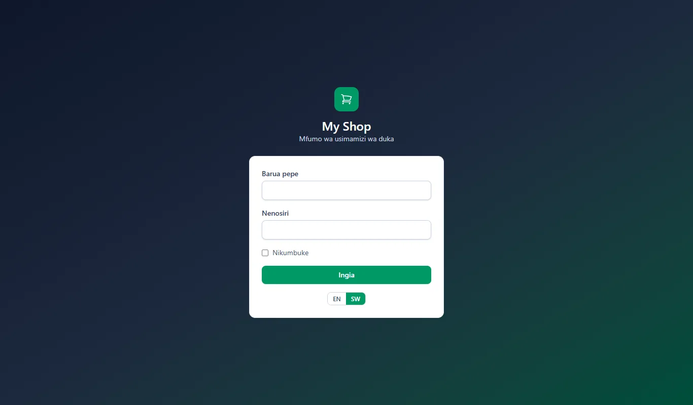

Kutoka, bonyeza jina lako juu kulia kisha chagua **Toka**. Kubadilisha jina, lugha au nenosiri, chagua **Wasifu wangu**.

## Dashibodi ya mmiliki

Dashibodi ni skrini ya kwanza anayoiona mmiliki. Inaonyesha hali ya duka leo:

- **Mauzo ya leo**, **Faida ya leo** (pamoja na matumizi ya leo), **Faida halisi ya mwezi huu** na **Madeni yanayodaiwa** (pesa ambazo wateja bado wanadaiwa).
- **Chati ya mauzo**: chagua **Kila siku** (siku 30 zilizopita), **Kila mwezi** (miezi 12 iliyopita) au **Kila mwaka**. Weka kishale juu ya nguzo kuona jumla na idadi ya mauzo ya siku, mwezi au mwaka huo.
- **Mauzo ya karibuni**: bonyeza mauzo kuyafungua.
- **Karibu kuisha muda**, **Mzigo mdogo** na **Wadaiwa wakubwa**: bonyeza bidhaa au mteja kumfungua.

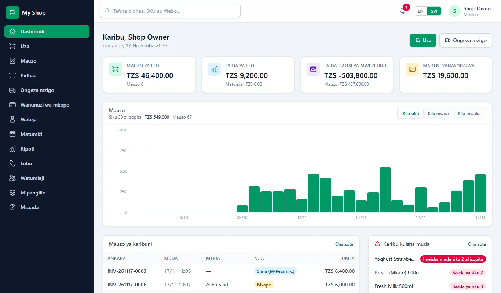

Vitufe vya juu kulia, **Uza** na **Ongeza mzigo**, vinakupeleka moja kwa moja kwenye kazi mbili unazofanya mara nyingi zaidi.

## Skrini ya mwanzo ya muuzaji

Muuzaji anapata skrini rahisi yenye vitufe vikubwa, iliyotengenezwa kwa skrini za kugusa:

- **Uza**: fungua kaunta.
- **Wateja wa mkopo**: nani anadaiwa, na kurekodi marejesho.
- **Mauzo yangu**: risiti zako, na kuzichapisha tena.
- **Wateja**, **Bidhaa** (angalia bei na stoo) na **Tahadhari**.

Alama nyekundu na za njano zinahesabu bidhaa zenye mzigo mdogo, wateja wanaodaiwa na tahadhari. *Mauzo yangu leo* inaonyesha jumla yako mpaka sasa. Upau wa juu (*Mwanzo*, *Uza*, *Mauzo yangu*, *Wanunuzi wa mkopo*) upo muda wote.

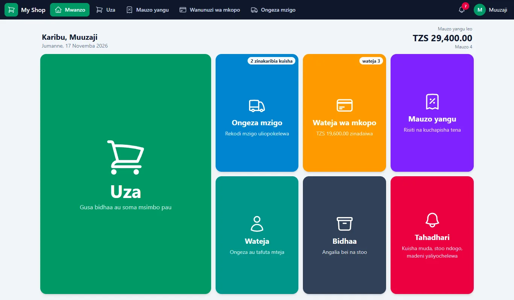

## Kuuza kaunta

Fungua kaunta kwa **Uza** (mmiliki na muuzaji).

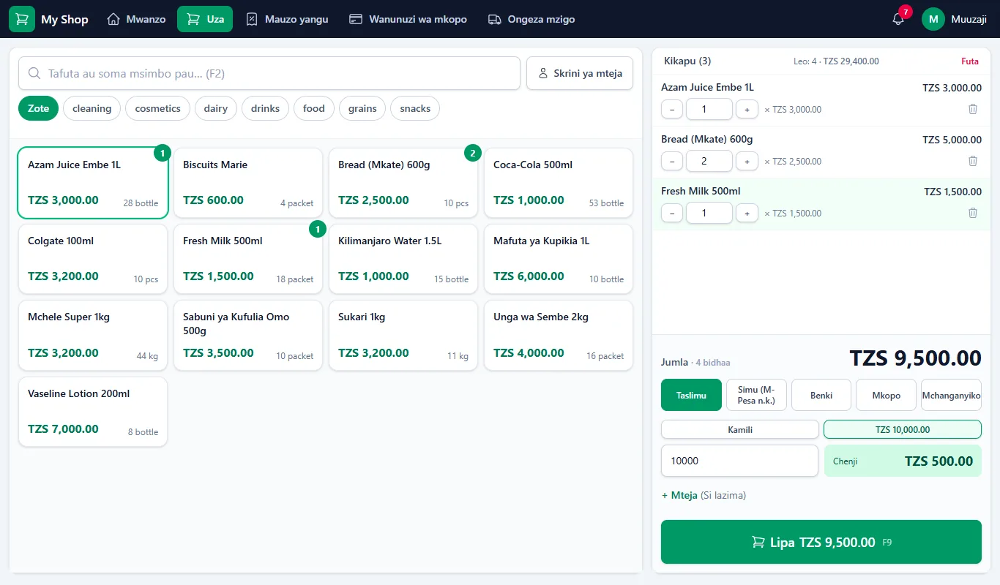

### 1. Ongeza bidhaa

- **Gusa kigae cha bidhaa**, au **soma msimbo pau** wake kwa skana. Kila mguso au usomaji unaongeza moja zaidi.
- Kutafuta bidhaa, andika sehemu ya jina, msimbo pau au lebo yake kwenye kisanduku cha kutafuta (bonyeza <kbd>F2</kbd> kwenda hapo). Tumia <kbd>↑</kbd> <kbd>↓</kbd> na <kbd>Enter</kbd> kuichagua.
- Vitufe vya makundi (*Zote*, *drinks*, *food*, …) vinaonyesha kundi moja la bidhaa kwa wakati mmoja.
- Kwenye **Kikapu** upande wa kulia, badilisha idadi kwa **−** na **+** au uiandike, na ondoa mstari kwa alama ya pipa. **Futa** inamwaga kikapu chote.

ShopApp haikuruhusu kuuza zaidi ya ulichonacho, na inakataa bidhaa zilizoisha muda kwa mlio wa onyo.

### 2. Pokea malipo

Chagua jinsi mteja analipa:

| Njia | Ufanye nini |
|---|---|
| **Taslimu** | Gusa **Kamili** au kiasi kilichozungushwa (au andika pesa iliyopokelewa). **Chenji** inahesabiwa kwa ajili yako. |
| **Simu (M-Pesa n.k.)** | Pesa kwa simu (M-Pesa, Tigo Pesa, Airtel Money…). |
| **Benki** | Kadi au uhamisho wa benki. |
| **Mkopo** | Mteja analipa sehemu sasa, au halipi kitu, na anadaiwa kilichobaki (angalia hapa chini). |
| **Mchanganyiko** | Sehemu taslimu, sehemu simu, sehemu benki. Andika kila kiasi; **Kilichobaki** kinaweka kiasi kilichosalia kwenye njia hiyo. Chenji inatoka kwenye sehemu ya taslimu. |

### 3. Bonyeza Lipa

Bonyeza **Lipa** (au <kbd>F9</kbd>). Mauzo yanahifadhiwa, stoo inapungua, na kisanduku kinaonyesha chenji ya kurudisha.

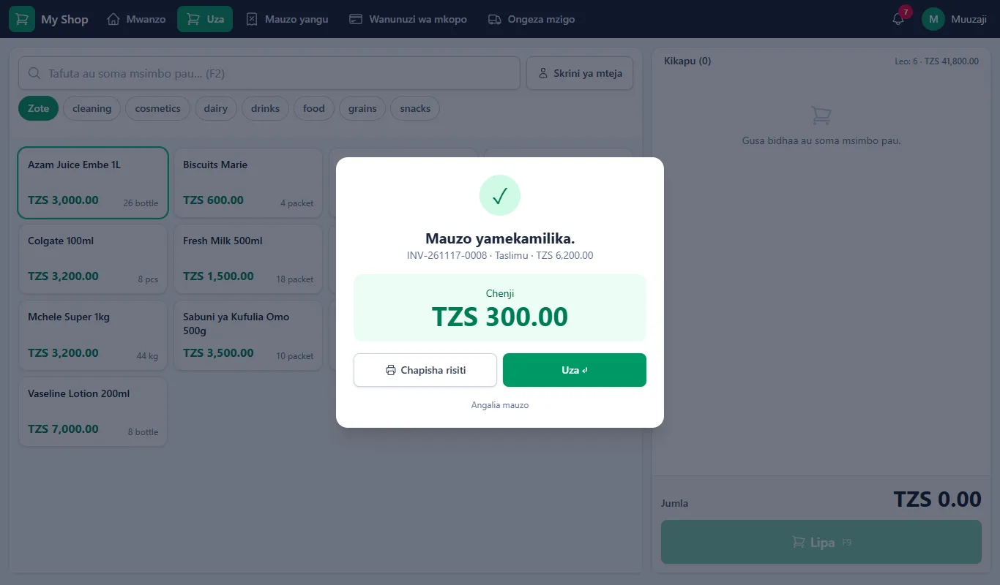

- **Chapisha risiti** inachapisha risiti. Kama *kuchapisha moja kwa moja* kumewashwa kwenye *Mipangilio*, inachapisha yenyewe.
- **Uza** (au <kbd>Enter</kbd>, au soma tu bidhaa inayofuata) inaanza mteja anayefuata.
- **Angalia mauzo** inafungua mauzo yote.

### Kuuza kwa mkopo

Chagua **Mkopo** na andika **kiasi kilicholipwa sasa** (0 kama hakuna). **Mteja anahitajika** ili deni lifuatiliwe: mchague kwenye orodha, au chagua *Mteja wa papo hapo / mpya* na andika jina na namba ya simu. Weka **tarehe ya kulipa** atakapotakiwa kulipa.

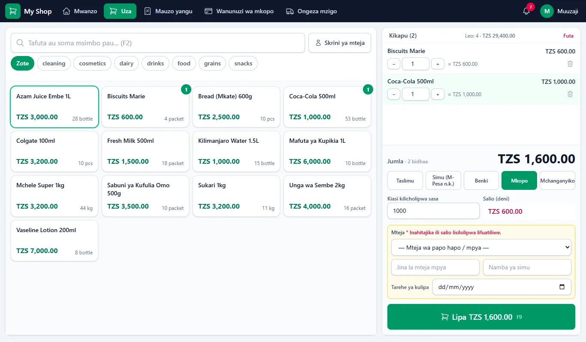

Ndivyo ilivyo pia malipo ya mchanganyiko yasipofikia jumla yote: kilichobaki kinakuwa mkopo.

Kwa mauzo ya taslimu, simu na benki, mteja si lazima. Gusa **+ Mteja** kama unataka mauzo yaandikwe kwa jina lake.

### Risiti

Risiti inaonyesha jina la duka, namba ya ankara, tarehe, muuzaji, mteja, bidhaa, jumla, kiasi kilicholipwa, na deni na tarehe ya kulipa kama yapo. Kwa faragha yako, **haionyeshi** njia aliyotumia mteja kulipa. Kuichapisha tena, fungua mauzo kutoka *Mauzo* (au *Mauzo yangu*) kisha bonyeza **Chapisha risiti**.

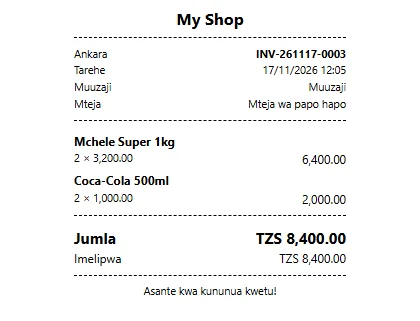

### Skrini ya mteja (skrini ya pili)

Kama kuna skrini ya pili inayomwangalia mteja, inaonyesha bidhaa zake unapozisoma, bidhaa ya mwisho kwa herufi kubwa, jumla ya kulipa, pesa iliyolipwa na chenji. Baada ya malipo inasema *Asante!* kwa sekunde 15, kisha inaonyesha skrini ya *Karibu*.

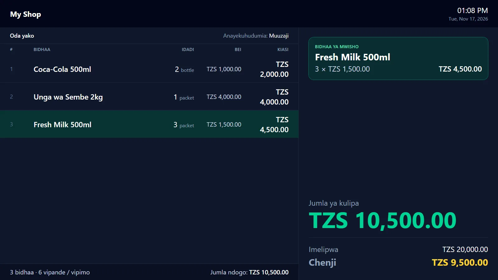

- **Programu ya Windows**: inafunguka kwenye skrini ya pili yenyewe. Iwashe au izime kwa <kbd>Ctrl</kbd>+<kbd>Shift</kbd>+<kbd>D</kbd> au kwenye *Mipangilio → Vifaa kwenye kompyuta hii*.
- **Kivinjari**: bonyeza **Skrini ya mteja** kwenye kaunta, buruta dirisha hadi skrini ya pili kisha bonyeza <kbd>F11</kbd>.

## Mauzo na risiti

**Mauzo** inaorodhesha kila mauzo (muuzaji anaona yake tu). Tafuta kwa ankara, mteja au simu, na chuja kwa tarehe, njia ya malipo au muuzaji. Bonyeza mauzo kuyafungua.

Kwenye mauzo unaweza:

- **Chapisha risiti** (printa ya risiti) au **A4** (ukurasa mzima).
- **Rekodi malipo** kama bado kuna deni (angalia *Wanunuzi wa mkopo*).
- **Futa mauzo** (mmiliki tu). Bidhaa zake zinarudi stoo. Tumia hii kwa makosa tu.

## Bidhaa

**Bidhaa** inaorodhesha kila kitu unachouza, pamoja na bei, stoo na tarehe ya kuisha. Tafuta kwa jina, msimbo pau au lebo, chuja kwa lebo au kwa *Stoo*, *Mzigo mdogo*, *Zimeisha* na *Karibu kuisha muda*, na panga kwa jina, bei, idadi, tarehe ya kuisha au mpya zaidi.

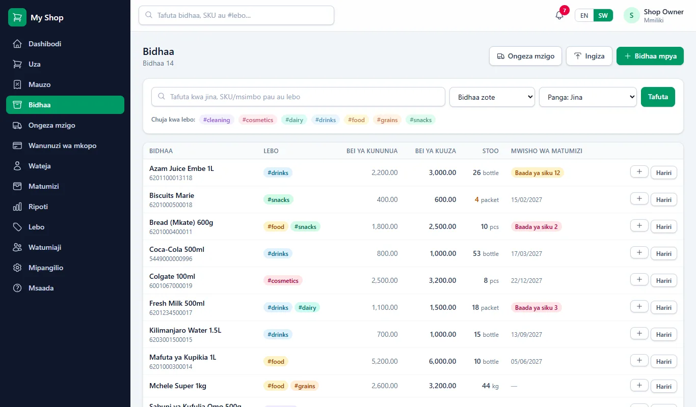

### Kuongeza au kuhariri bidhaa (mmiliki)

Bonyeza **Bidhaa mpya**, au **Hariri** kwenye bidhaa:

- **Jina la bidhaa** (lisijirudie) na **SKU / Msimbo pau**. Soma msimbo pau kishale kikiwa kwenye kisanduku hicho.
- **Kipimo** (pcs, chupa, kg, pakiti…).
- **Bei ya kununua** na **Bei ya kuuza**. **Faida kwa kipimo** inaonyeshwa unapoandika.
- **Idadi iliyopo stoo** na **Kiwango cha kuagiza tena**: stoo ikishuka hadi kiwango hicho, bidhaa inaonekana kwenye *Mzigo mdogo*.
- **Tarehe ya kuisha muda** (si lazima) na **Lebo**. Andika lebo mpya ukizitenganisha kwa koma.

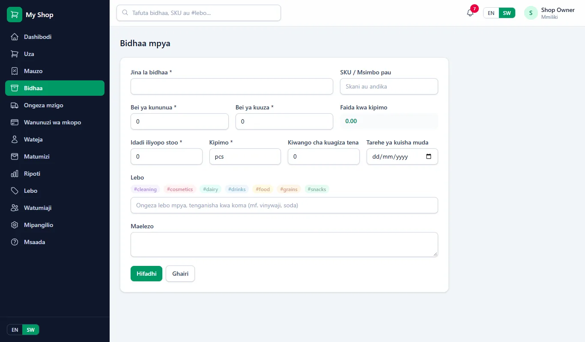

### Kuingiza bidhaa nyingi kwa mara moja (mmiliki)

**Bidhaa → Ingiza** inaongeza orodha nzima kutoka faili la CSV:

1. Bonyeza **Pakua kiolezo** na ukifungue kwenye Excel.
2. Jaza bidhaa moja kwa kila mstari: `name`, `buying_price` na `selling_price` ni lazima; `sku`, `unit`, `quantity`, `reorder_level`, `expiry_date`, `tags` (zitenganishwe kwa `;`) na `description` si lazima.
3. Hifadhi kama **CSV** (*File → Save As → CSV*), chagua faili kisha bonyeza **Ingiza**.

Mistari ambayo jina lake tayari lipo inarukwa na kuorodheshwa, ili uirekebishe.

> **Misimbo pau kwenye Excel:** weka safu ya msimbo pau kuwa **Text** kabla ya kuandika. La sivyo Excel inageuza misimbo mirefu kuwa `6.00123E+12` na inapotea.

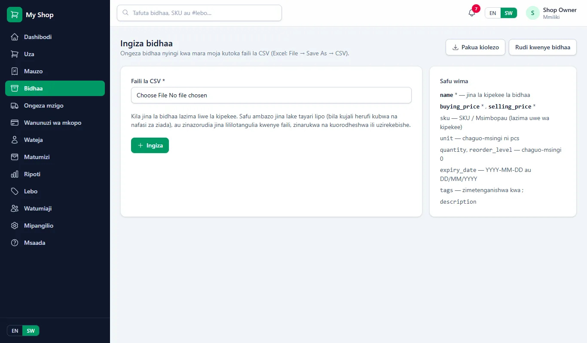

## Kuongeza mzigo (mzigo uliopokelewa)

Mmiliki pekee ndiye anaweza kuongeza mzigo. Mzigo ukifika, fungua **Ongeza mzigo**:

1. Gusa kila bidhaa kwenye orodha upande wa kushoto, au isome kwa skana. Kupokea kitu kipya, bonyeza **Bidhaa mpya** kwanza.
2. Upande wa kulia, andika **Idadi** iliyopokelewa na, kama mzigo una tarehe, **Tarehe ya kuisha muda**. Unaweza pia kubadilisha **Bei ya kununua** na **Bei ya kuuza**.
3. Ukipenda, andika **Msambazaji**. **Jumla ya gharama** inaonyeshwa.
4. Bonyeza **Hifadhi mzigo**.

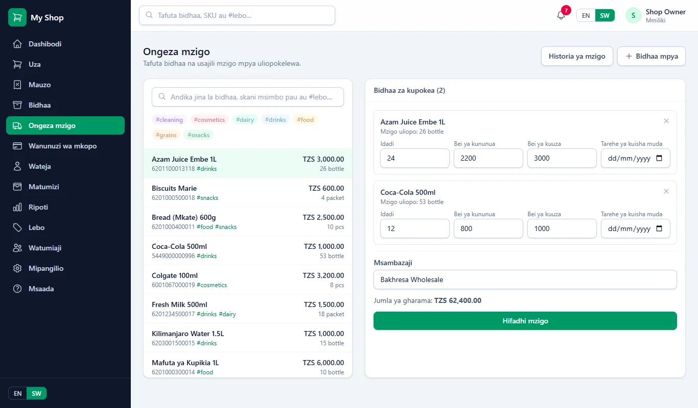

**Historia ya mzigo** inaorodhesha kila mzigo uliopokelewa, kwa tarehe na msambazaji.

## Wanunuzi wa mkopo na marejesho

**Wanunuzi wa mkopo** inaonyesha nani anadaiwa na duka: **jumla ya madeni**, deni la kila mteja (**Kwa mteja**) na kila **ankara isiyolipwa** pamoja na tarehe yake ya kulipa. Ankara zilizopitiliza zinaonyeshwa kwa rangi nyekundu.

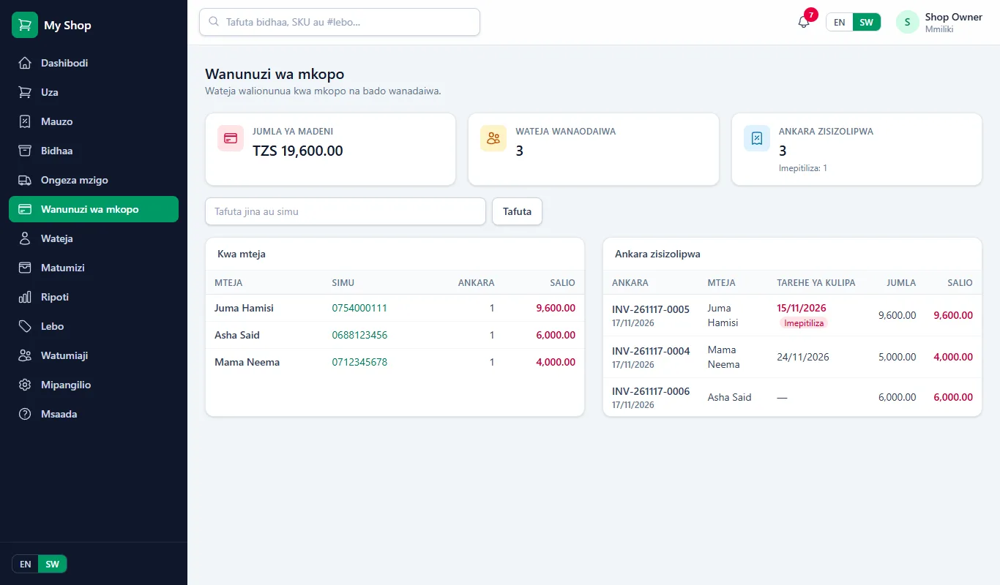

### Kurekodi marejesho

Wateja wanaweza kulipa kidogo kidogo:

1. Bonyeza ankara (au fungua mteja, kisha ankara).
2. Kwenye **Rekodi malipo**, andika kiasi, chagua njia aliyolipia, na ongeza kumbukumbu ukipenda.
3. Bonyeza **Hifadhi malipo**. Deni linapungua. Likifika sifuri, ankara imelipwa.

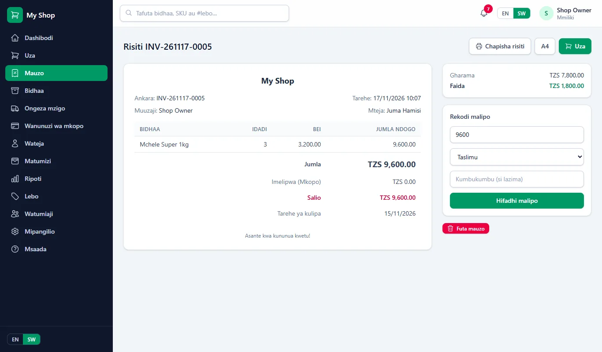

### Wateja

**Wateja** inahifadhi majina, namba za simu na anwani. Ukurasa wa mteja unaonyesha kila alichonunua, alicholipa na anachodaiwa bado. Mmiliki pekee ndiye anaweza kufuta mteja.

## Tahadhari

**Kengele** iliyo juu inaonyesha idadi ya mambo yanayohitaji kuangaliwa. Ukurasa wa **Tahadhari** unaorodhesha:

- **Bidhaa zilizoisha muda** ambazo bado zipo stoo: ziondoe kwenye rafu.
- **Karibu kuisha muda**: bidhaa zitakazoisha ndani ya siku zilizowekwa kwenye *Mipangilio* (30 kwa kawaida).
- **Mzigo mdogo**: bidhaa zilizofika au kushuka chini ya kiwango cha kuagiza tena. Mmiliki anaweza kubonyeza **Ongeza mzigo** kuongeza.
- **Madeni yaliyopitiliza**: ankara zilizopita tarehe ya kulipa.

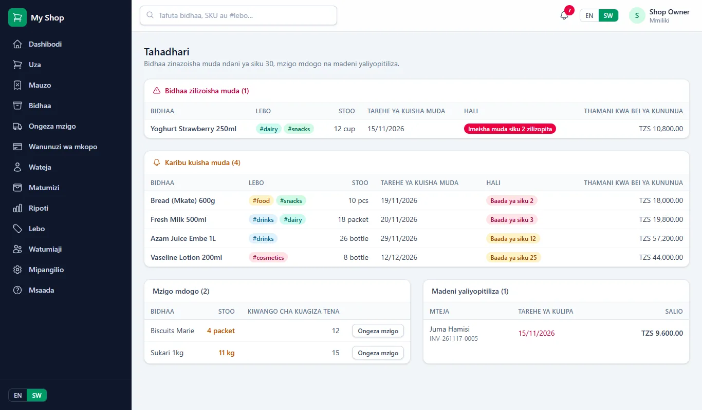

## Matumizi (mmiliki)

Rekodi gharama za duka, kama umeme (LUKU), maji, chakula, mishahara, kodi ya pango, usafiri, kodi na matengenezo. Bonyeza **Ongeza matumizi**, kisha chagua **tarehe**, **aina** na **kiasi**, na ongeza maelezo. Chuja orodha kwa aina na tarehe. Matumizi yanatolewa kwenye faida katika *Ripoti* na kwenye dashibodi.

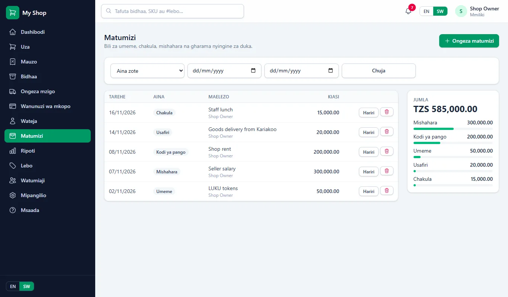

## Ripoti (mmiliki)

**Ripoti** inaonyesha hali ya duka kwa **siku**, **mwezi** au **mwaka**. Chagua kipindi na tarehe (na muuzaji ukipenda) kisha bonyeza **Onyesha ripoti**.

- **Mapato**, **Gharama ya bidhaa**, **Faida ghafi**, **Matumizi** na **Faida halisi**.
- **Pesa iliyopokelewa** (pamoja na marejesho ya madeni) na **Iliyouzwa kwa mkopo (haijalipwa)**.
- Mgawanyo kwa saa, siku au mwezi, **Bidhaa zinazouzwa zaidi**, **Njia za malipo**, **Mauzo kwa muuzaji** na **Matumizi kwa aina**.

Bonyeza **Chapisha** kupata nakala ya karatasi, au **CSV** kufungua takwimu kwenye Excel.

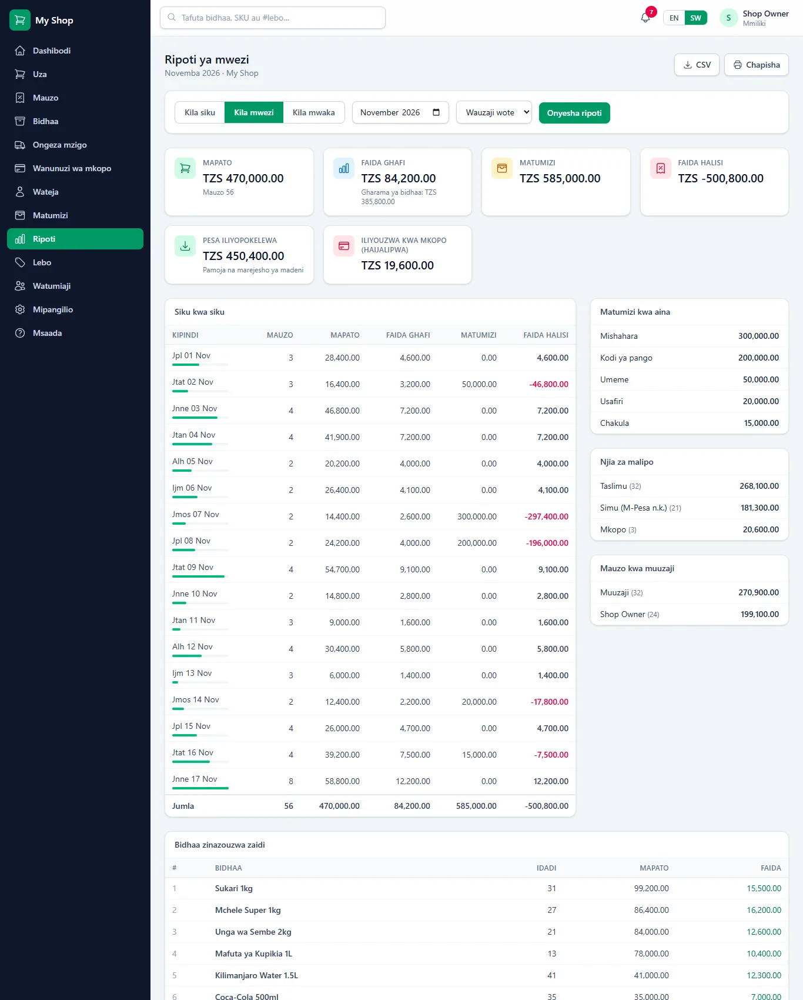

## Lebo (mmiliki)

Lebo zinapanga bidhaa katika makundi, kama *drinks*, *food* au *cosmetics*, ili uzipate haraka. Zinakuwa vitufe vya makundi kwenye kaunta. Tengeneza lebo kwa jina na rangi, kisha zipe bidhaa lebo zake kwenye fomu ya bidhaa.

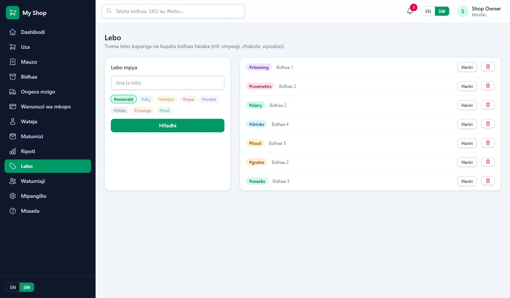

## Watumiaji (mmiliki)

**Watumiaji** inaorodhesha kila mtu anayeweza kuingia. Bonyeza **Mtumiaji mpya** kisha weka jina, barua pepe, nenosiri, **wadhifa** (mmiliki au muuzaji) na lugha. Kumzuia mtu kuingia bila kufuta historia ya mauzo yake, ondoa alama kwenye **Hai (anaweza kuingia)**.

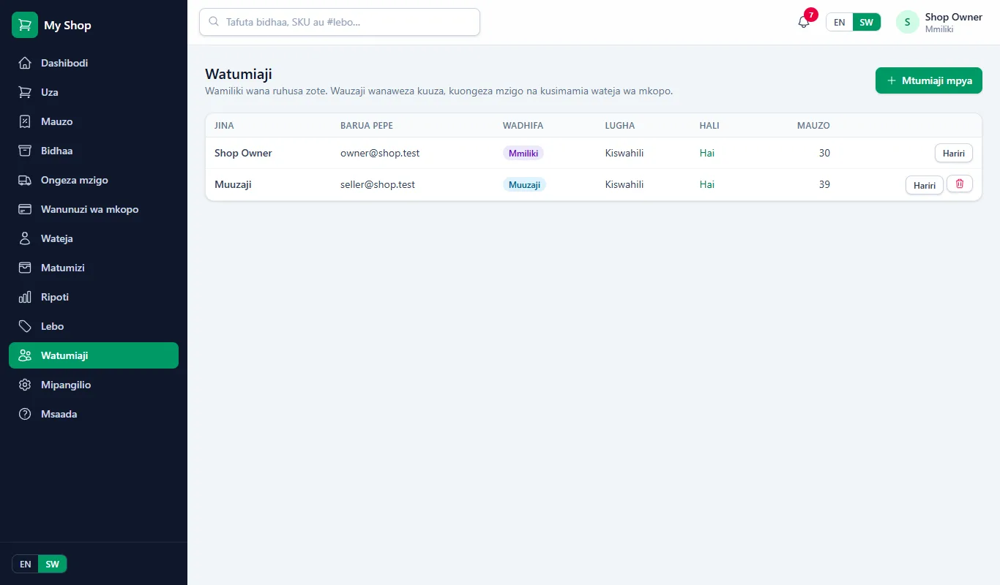

## Mipangilio (mmiliki)

- **Duka**: jina la duka, simu, anwani (vinachapishwa kwenye risiti) na sarafu.
- **Tahadhari ya kuisha muda**: siku ngapi kabla ya kuisha bidhaa ionekane kama *karibu kuisha muda*.
- **Printa ya risiti na skana ya msimbopau**: upana wa karatasi ya risiti (58 au 80 mm), maandishi ya chini ya risiti (kwa mfano *Bidhaa zilizouzwa hazirudishwi*), **chapisha risiti moja kwa moja baada ya kila mauzo**, na mlio msimbo pau unaposomwa. **Chapisha risiti ya majaribio** inakagua printa.
- **Nakala za akiba**: ShopApp inahifadhi nakala ya taarifa za duka yenyewe. Chagua **mara ngapi** (kila saa, siku au wiki), **saa ngapi**, na **idadi ya nakala za yenyewe za kubakiza**. Kompyuta ikiwa imezimwa wakati huo, nakala inahifadhiwa mara tu ShopApp inapofunguliwa tena. Kwa usalama zaidi, chagua folda kwenye **flash (USB) au OneDrive / Google Drive** ipokee nakala ya kila backup. **Hifadhi nakala sasa** inahifadhi moja papo hapo, na *Nakala za karibuni* zinakuwezesha kuzipakua. Kwenye programu ya Windows unaweza pia kuhifadhi nakala ShopApp inapofungwa, kufungua folda ya nakala na **kurudisha nakala**.
- **Vifaa kwenye kompyuta hii** (programu ya Windows tu): printa ya kutumia, njia ya kuchapisha, kufungua droo ya pesa kwa kila risiti, skrini ya mteja, kibodi ya skrini, na kisanduku cha kujaribu skana.

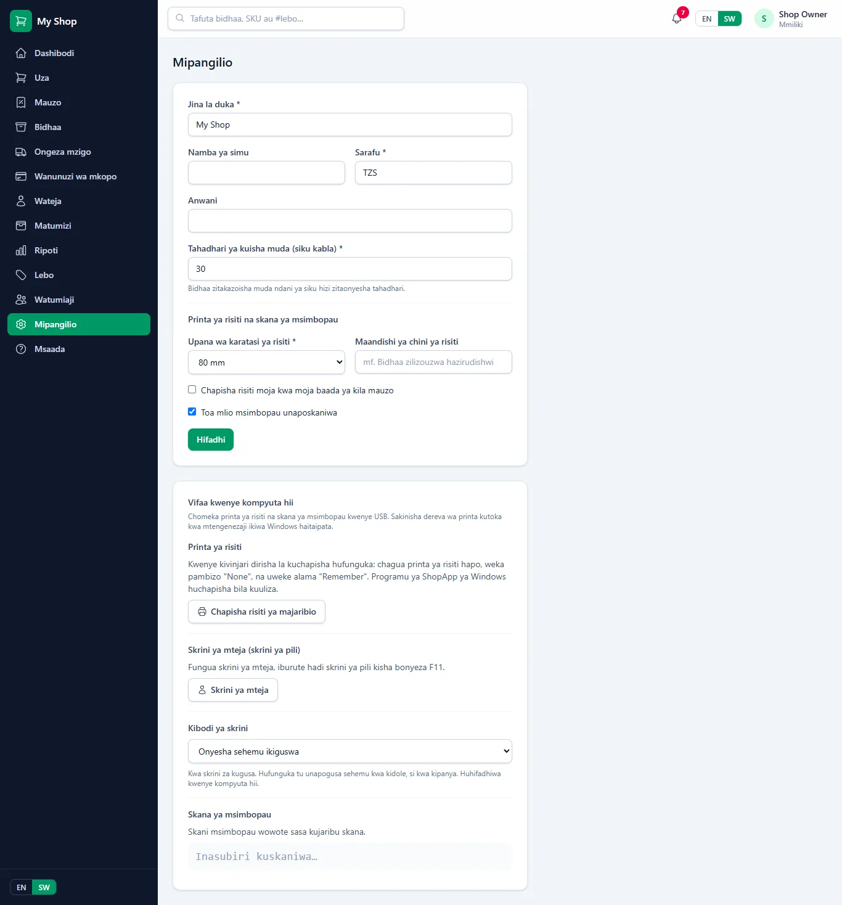

## Skana ya msimbo pau na printa ya risiti

**Skana ya msimbo pau** (USB au Bluetooth): ichomeke kisha soma. Haihitaji maandalizi yoyote.

| Unaposoma | Kinachotokea |
|---|---|
| Kaunta | Bidhaa inaongezwa kwenye kikapu, au idadi yake inaongezeka kwa moja. |
| Ongeza mzigo | Bidhaa inaongezwa, au idadi yake inaongezeka kwa moja. |
| Bidhaa mpya / kuhariri bidhaa | Msimbo unaingia kwenye *SKU / Msimbo pau*. |
| Mahali pengine popote | Bidhaa inafunguka. Msimbo usipojulikana, mmiliki anapewa bidhaa mpya yenye msimbo huo tayari. |

**Printa ya risiti** (ya joto, 58 au 80 mm): ichomeke na uweke driver ya mtengenezaji kama Windows haitaipata. Kwenye programu ya Windows, risiti zinachapishwa papo hapo bila dirisha la kuchapisha. Kwenye kivinjari, chagua printa ya risiti kwenye dirisha la kuchapisha, weka *margins* kuwa *None*, na kivinjari kitakumbuka.

**Droo ya pesa**: ichomeke kwenye printa, kisha weka alama kwenye *Fungua droo ya pesa kila risiti* chini ya *Mipangilio → Vifaa kwenye kompyuta hii*.

## Programu ya Windows

- **Kukagua tarehe**: kila ShopApp inapoanza, thibitisha kwamba tarehe na saa ya kompyuta ni sahihi. Mauzo, tahadhari za kuisha muda na ripoti zinategemea hizo.
- **Nakala za akiba (backup)**: nakala zinahifadhiwa zenyewe kwa ratiba iliyowekwa kwenye *Mipangilio → Nakala za akiba*, na pia kabla ya kila sasisho. Tumia **File → Back up data now** wakati wowote, na **File → Restore a backup…** (au *Mipangilio → Nakala za akiba → Rudisha nakala ya akiba…*) kurudi kwenye nakala. Kurudisha kunahifadhi kwanza nakala ya taarifa za sasa, kisha ShopApp inajifungua upya.
- **Masasisho**: ShopApp inakagua masasisho inapoanza (na kwenye **Help → Check for updates**), inayapakua, kisha inaomba kuanza upya.
- **Njia za mkato**: <kbd>F1</kbd> mwongozo huu · <kbd>F11</kbd> skrini nzima · <kbd>Ctrl</kbd>+<kbd>Shift</kbd>+<kbd>D</kbd> washa/zima skrini ya mteja · <kbd>Ctrl</kbd>+<kbd>Shift</kbd>+<kbd>M</kbd> onyesha/ficha upau wa menyu.
- **Skrini za kugusa**: ukigusa kisanduku kwa kidole, kibodi ya skrini ya ShopApp inafunguka. Unaweza kuizima kwenye *Mipangilio → Vifaa kwenye kompyuta hii*.

## Maswali na matatizo

**Msimbo pau haupati bidhaa.** Usome kwenye *Mipangilio → Vifaa kwenye kompyuta hii → Skana ya msimbopau* kuona hasa skana inatuma nini, kisha rekebisha *SKU / Msimbo pau* wa bidhaa.

**Risiti inatoka tupu au ndogo sana.** Kagua upana wa karatasi kwenye *Mipangilio*, kisha tumia **Chapisha risiti ya majaribio**. Kwenye programu ya Windows, acha njia ya kuchapisha kwenye *Moja kwa moja kwa printa ya risiti (ESC/POS)*.

**Siwezi kuuza bidhaa.** Labda imeisha stoo (ongeza mzigo kwanza) au imeisha muda (haiwezi kuuzwa).

**Mauzo yaliingizwa vibaya.** Mmiliki anaweza kuyafungua na kubonyeza **Futa mauzo**. Bidhaa zake zinarudi stoo. Kisha yaingize upya.

**Muuzaji amesahau nenosiri.** Mmiliki anafungua *Watumiaji*, anahariri muuzaji na kuandika nenosiri jipya.

**Sioni Ripoti, Matumizi au Mipangilio.** Hizo ni za mmiliki tu.
